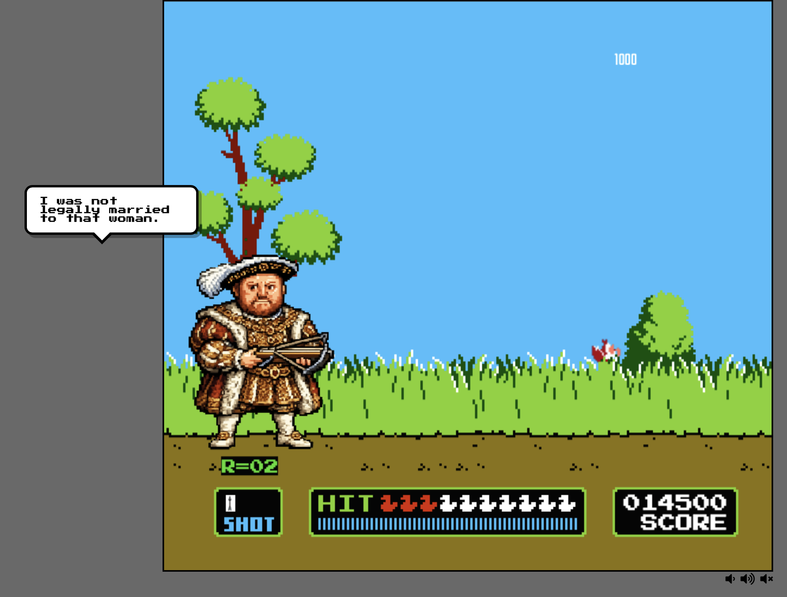
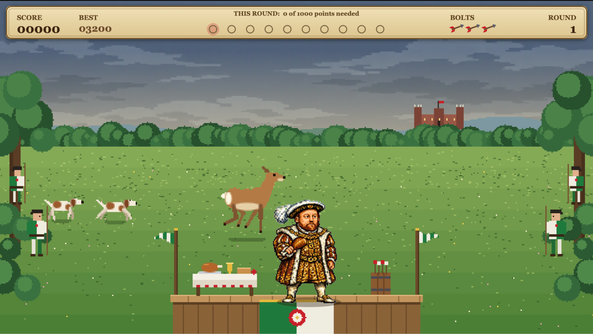
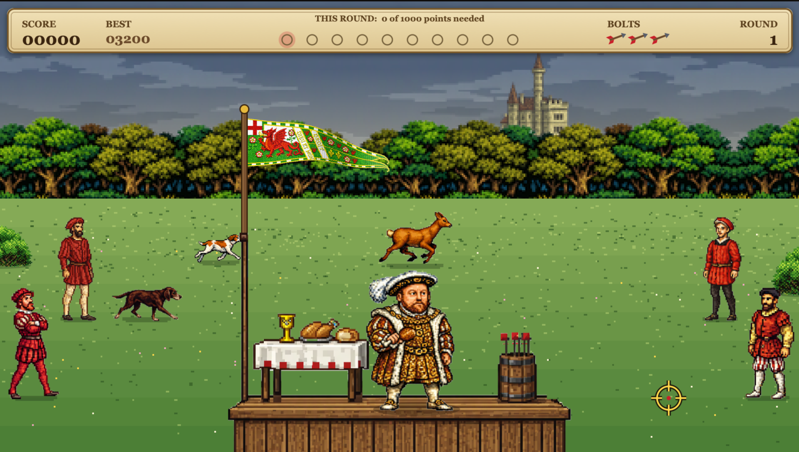

When you work at the Roy Rosenzweig Center for History and New Media (RRCHNM), one of the operative terms there is *new media*. Over the course of our center’s existence, we’ve evolved from CD-ROMs to websites, and our mission statement calls on us to use digital media and computer technology to democratize access to history. In the 2020s, this requires us to consider what benefits we can—and can’t—derive from recent advances in Machine Learning (ML) or, as the marketing gurus have successfully rebranded it—Artificial Intelligence (AI).

When we first decided to have an “AI Day” in January 2026 to explore what frontier models (specifically Claude Code) could do for us at RRCHNM, I wasn’t originally sure what I might want to work on. As someone who can program a little, design a little, and historian a lot, there was no obvious part of my research agenda I might want to cede to a probabilistic algorithm. Finally, I dusted off a slightly zany idea I had come up with while reading Simon Thurley’s *Tudor Houses of Power* which tells the story of Tudor England through the places and spaces that various monarchs ruled from. Specifically, it talked about the hunts of Henry VII and Henry VIII.

As a child, my parents finally broke down to my brother and my begging and bought us a Nintendo Entertainment System. One of the games I remember best is *Duck Hunt*. And while reading Thurley’s book, my brain immediately went: “What if Duck Hunt… but with Henry VIII?”

I spent a very long day trying to get this idea to work. Claude’s first suggestions for how to implement a Duck Hunt with Henry VIII game began with killing everyone. Seriously.

Luckily, it was quite easy to get the bloodthirsty AI under control (I’m sure Isaac Asimov was rolling over in his grave and shouting “First Law of Robotics! First Law of Robotics!”) as I clarified that this wasn’t a first-person shooter game taking down the entire Henrician Court but rather a hunting scene grounded in historical reality. However, that was the only easy part. Attempts to get Claude Code synched with Unity (the software I’d originally thought I’d program with) did not work and I finally fell back on just coding in HTML5. Or rather, [cloning someone else’s version of Duck Hunt coded with HTML5](https://github.com/Adi52/duck-hunt) and slapping a ChatGPT-generated image (or sprite) of Henry VIII on top of it. Attempts to replace the dog with a servant in green-and-white striped livery were more laughable. By the end of the day, I had a game with a Henry and speech bubbles like “I am the King of England. I hunt ducks.” But it wasn’t *my* game. If I were to make up statistics, I’d guess it was 90% the work of someone else, 9% the work of various AI agents, and 1% my input.

Flash forward ten months to Claude Fable 5.2 and [an article that our systems administrator shared](https://notesbylex.com/fable-5-2-one-shotted-my-nephews-dream-game) about “one shotting” or creating a game from a single prompt using that model. I realized that I temporarily had access to Fable through my RRCHNM Claude account (over the past year I’ve noticed Anthropic often gives “special access” to things at random, presumably because they’re trying to hook you on their product) so I decided to give Duck Hunt with Henry VIII a second attempt.

I started off instructing Claude Sonnet 4.6 to give me a quick outline of the assets I needed to generate:

> I want to vibecode a “Duck Hunt with Henry VIII” based off the old Duck Hunt game. Assuming I will be doing this using Claude Code Opus or Fable with sprite images generated via ChatGPT 5.4. I want to do this with HTML5 so that the final content will be easier to host and sustain. What are the steps I will need to follow? What is the list of sprites I will need to generate in ChatGPT 5.4?

Claude once again assumed that I wanted to start by murdering everyone. The “ducks flying across the screen” should be replaced with “Henry’s wives/courtiers fleeing” and I would need to create sprites of “Wife flying right,” “Wife flying left,” “Wife hit (stunned),” and “Wife falling.” Perhaps I might want an “Optional second target type: A fleeing Cardinal (red robes, wide hat)—same frame structure, just different colors/silhouette.”

FIRST LAW OF ROBOTICS, Claude, FIRST LAW OF ROBOTICS.

I did a few more iterations of planning with Sonnet and generated a few more sprites of Henry VIII with OpenAI’s GPT 5.4 then moved to Claude Fable 5.2 and gave it access to a folder with my sprites and the following instructions:

> create a version of the classic NES Duck Hunt game, but starring Henry VIII hunting deer.
>
> To get you started, this folder includes the folder “Original Vibe Coding Duck Hunt” which was built by doing some rough/poor modifications of someone else’s HTML5 coded recreation of the original Duck Hunt. This folder also includes duck-hunt-henry-viii-plan.md which was Sonnet 4.6’s idea of how to implement the game and a folder of Assets where I have begun to deposit sprites generated with ChatGPT 5.4. these assets can be used or not used depending on how helpful they are.
>
> here also is the original prompt I used to generate the plan with Sonnet: Henry VIII should be hunting deer with a crossbow. he is standing on a platform feasting with his crossbow while servants and dogs flush the deer to run across / around the screen in front of the platform. there should be three deer type: regular deer, deer with a really amazing rack of horns, and a deer with a pretty leather / embossed / jeweled collar. before a deer with the amazing rack of horns comes by, a hunting horn should sound to call your attention to it. shooting a regular deer gets you 100 points. shooting a deer with an amazing rack of horns should get you 500 points. shooting a deer with a collar on it should zero out all your points and a weeping noblewoman comes out to cry because you killed her pet deer. out of 10 deer, 1 should be a pet, 7 should be ordinary, and 2 should have good racks of horns.

Fable’s first attempt was… actually pretty good. It had all the functionality I’d asked for, even if the graphics it generated were subpar. I spent time using GPT to generate more 16-bit artwork from historical images of Greenwich Castle, early modern hunting dogs, and the servants from the Field of the Cloth of Gold painting, plus Henry’s banner, and generic landscaping. I asked for some UI changes around how mute works as well as an “About” page. Then, on a whim and to give it an existence beyond a “toy” DH project, I had Fable add in an “Education mode” that provides the player with facts about Henry VIII’s life. I wrote the first series of them but then, as a shortcut to finish the concept model more quickly, had Sonnet concatenate its own generated facts with facts it scraped from my undergraduate Tudor course’s lecture notes.

By this point, it was clear the game had gone beyond an experimental exercise, so I also had Fable spend time 1) making it mobile responsive and 2) making it WCAG 2.1 AA accessible, to the greatest extent possible. At the end of all this, I had a game that my students could play for fun and maybe even also for education.

The game is CC0 because I do not consider myself to have contributed enough to this exercise to exert a copyright claim to the results. I was a human “in the loop”—if there was a way to “one shot” this, I obviously missed the memo—but the vast majority of this work was done by agents.

I snarkily titled this blog post “Love and Labor: Lost” and that is my summary of this experience. I am pleased enough with the results that I would share this with my students, but there’s no love the way I feel for projects I’ve spent months or even years laboring over. That’s because my “labor” for this consisted of writing prompts, finding historical images, lolsobbing over AI not producing the results I wanted, and then prompting again until I finally got something close to what I’d imagined. That’s nothing compared to the real labor I would have put in if I had actually done this from scratch the way I’d originally intended when I put “Duck Hunt with Henry VIII” on my backburner of DH project ideas.

In short: in losing the labor, I also lost the love.

That said, there is no way this project would have ever happened without AI. My backlog of things I need to get to is so long, I don’t even want to think about it. This idea is amusing and will be fun to teach with, but it’s not the kind of intellectually rigorous scholarship that I prioritize in my research agenda. I don’t regret making it, especially as it’s helped me explore what current frontier AI models are and aren’t capable of (seriously, is OpenAI or Anthropic going to kill us all?) but I wouldn’t prioritize it over many other projects in my queue.

There’s also a very obvious path forward for this project, that I laid the foundations for while coding this game. Fable did and will always have created the base Javascript code that makes the game work, but the interesting intellectual labor—in my mind—would have come from creating the 16-bit pixel art—all conveniently collected together in an assets folder—and the text associated with the game—specifically the “facts” which I had served from an easily edited markdown file.

The first and most straightforward way to reclaim the labor and the love will be to write the game-provided biographical facts from scratch, reclaiming the task of writing Henry VIII’s biography for me as a human and an expert in Tudor English history. While I wrote the first half-dozen facts to provide the framework for the whole game, the remainder of the “facts” are not mine even if AI used my notes to generate them. I expect to do this before I actually let any of my students play it as part of a coursework experience.

Second, and more time-consuming but equally as important to someone who works in a History *and* Art History department, will be to recreate all the sprites and background art manually. GMU has sadly revoked all its faculty’s Adobe Creative Commons licenses this year (a financial exigency, I’m sure) so I’ll need to either beg an exemption out of our IT department or get my own personal software for this, but doing the intellectual labor of creating these modern renditions of historical art will be a worthwhile and (dare I say it) fun exercise that I expect will teach me a significant amount about both digital and historical art.

Both of these things will be time-consuming. They will require me to *labor*. But in doing so, I expect to be able to reclaim my lost *love* for this project and make it mine enough that I can actually say “I” had more than a token hand in creating it.

You can play the game at [https://jmotis.github.io/TudorDeerHunt/index.html](https://jmotis.github.io/TudorDeerHunt/index.html) . Type “O” to see the Fable-generated original artwork.

The game code and AI-generated graphics are available here under a CC0 license: [https://github.com/jmotis/jmotis.github.io/tree/master/TudorDeerHunt](https://github.com/jmotis/jmotis.github.io/tree/master/TudorDeerHunt)
